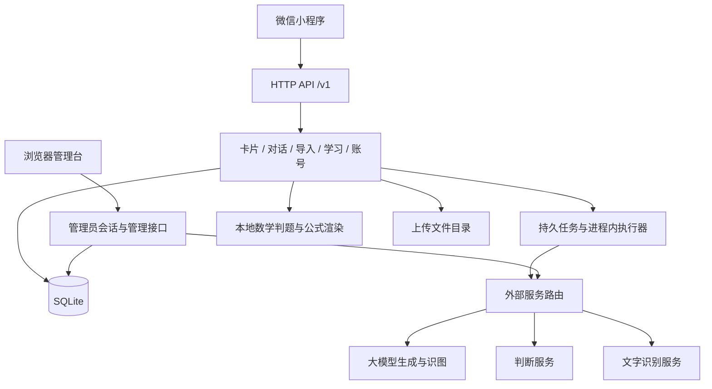

# 架构与数据流

当前实现为原生微信小程序、Fastify 模块化单体和 SQLite，另有同源管理台。模块按业务划分，外部调用集中在服务端；小程序不保存外部服务密钥。

## 模块分工

| 领域 | 模块目录 | 负责什么 |
| --- | --- | --- |
| 卡片与随心记 | `cards`、`notes`、`resume` | 原话、结构化卡片、补充与关联、旧笔记兼容、回顾与接续 |
| 对话与工具 | `chat`、`mistakes` | 对话流、图片附件、解题与批改、历史和错题 |
| 导入与头脑风暴 | `imports`、`brainstorm` | 文件解析、确认原文、拆卡、选卡汇总与保存 |
| 学习 | `learn`、`study`、`review`、`study-time`、`materials` | 高数地图、程序判题、资料学习、复习与时长 |
| 身份与管理 | `auth`、`account`、`admin` | 用户会话、管理员会话、同意、导出注销、配置和统计 |
| 共用能力 | `jobs`、`safety`、`render`、`assets`、`legal` | 持久任务、心情与风险边界、排版、素材和法律文档 |

目录均位于 `server/src/modules/`。入口 [index.ts](../server/src/index.ts) 负责装配；`routes.ts`处理请求校验与鉴权，`service.ts`处理业务，必要时再拆同领域文件。`providers/`只负责外部协议和调用，`shared/`存放数据库、时间、预算、计量与共用错误。

## 三条主要数据流

**记录到卡片。** 用户保存原话后创建卡片；整理任务把原文转换为结构化内容。用户的原话和自己填写的理解与生成结果分开保存。后续编辑、合并、补充、删除都要保持归属、版本和来源关系，不把过期任务结果覆盖到新版本。

**资料到学习。** 文字或文件先形成材料／导入记录，识别结果供校对和确认；讲解、自测和拆卡引用被选定的原文。作答优先使用程序规则；无法可靠判定时返回不确定。学习地图的预置题判定走本地程序，不依赖远程生成服务。

**请求到任务。** 较长操作先写任务状态，再由进程内执行器处理；客户端按任务或业务记录恢复进度。流式对话使用 SSE 逐步输出，断开客户端连接不等于撤销服务端处理。幂等标识、内容版本和会话代际分别防止重复提交、覆盖新内容与跨账号回显。

## 数据与计量

SQLite 的建表、升级和兼容补列集中在 [store.ts](../server/src/shared/store.ts)。从已有数据升级必须经过原迁移链；不要删除历史迁移或修改存储标识来整理品牌文字。

业务数据按用户隔离。资料版本、卡片、对话、复习、任务等保存正文或派生内容；个人额度凭证和成功消耗记录用于日／周预算；匿名调用总账记录每次外部网络尝试，不保存学习正文。三种记录的用途不同，不能简单合并或用调用次数推算实付账单。

当前用户额度按管理台价格表计算成功操作的金额预算，另有每日安全次数上限。账单仍需与服务方核对。复习、额度与业务日期按北京时间处理；界面“今天／昨天”等展示可以按设备本地日期显示。

上传目录保存资料、聊天图片和处理中导入文件；同一图片可能被多个业务对象引用，只有最后一个引用消失后才能删除。完整备份必须包括数据库和整个上传目录；公式缓存可以重新生成。

## 维护边界

- 一个 API 进程对应一个本地 SQLite 数据库；限流、任务执行和管理员会话包含进程内状态，不支持多个进程共享数据库并行提供服务。
- 管理台是单一管理员身份，用户账号与管理员会话分离；没有员工角色系统。
- 外部接口由适配器隔离，但更换服务仍需验证结构化输出、流式输出、识图和错误处理。
- Web/H5 身份绑定、分布式任务队列、多实例高可用均未实现。
- 自动测试覆盖程序行为；真实识别效果、真实设备体验和服务方账单需要单独核实。

按模块定位文件和修改步骤见 [代码地图](code-map.md)，运行与配置见 [后端运行](backend.md)。
